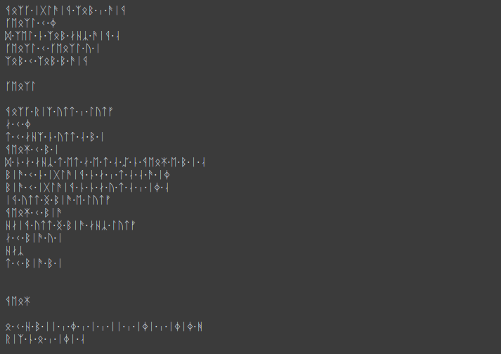
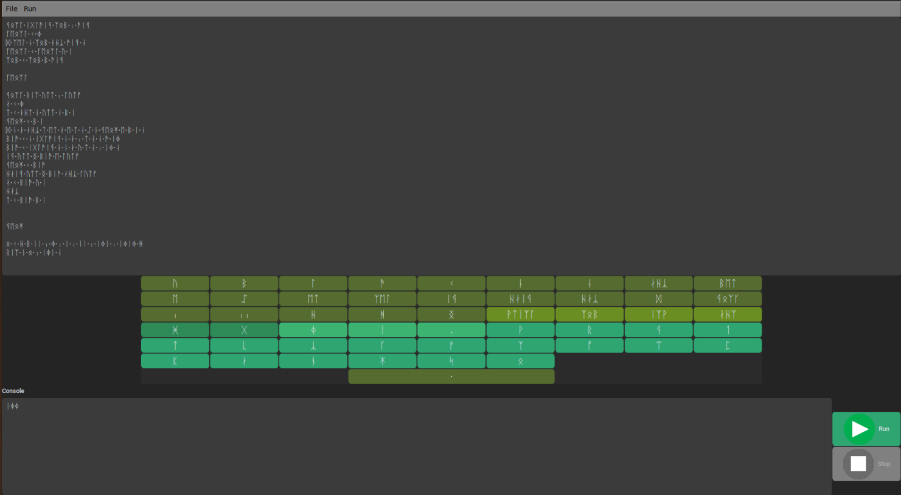

## Introduction
Rune++ is an [esoteric programming language](https://en.wikipedia.org/wiki/Esoteric_programming_language) which only uses rune characters, inspired by JRR Tolkien's rune alphabets used in the Lord of the Rings and his other works. The purpose for making this is purely for fun and to make something unique, because as far as I know, there are no other similar languages available. It is written in Python, meaning that Rune++ is therefore an interpreted, interpreted language (obviously not optimised for speed, just for fun)!

Rune++ is not intended for practical use, but as an exploration of language design within a novel theme.


<br>
***Binary search implemented in Rune++***
<br>
<br>

Although Rune++ programs can be run directly from the command line, it is easier to do so via the Rune++ IDE as this includes a customised on-screen keyboard, without which it is very difficult to write programs due to the unusual characters.

<br>
***Rune++ IDE***
<br>
<br>

## Technical Overview
Rune++ consists of:
- A lexer that converts rune characters into tokens
- A parser that generates an abstract syntax tree (AST)
- An interpreter that executes the AST
- A CustomTkinter-based IDE with a specialised rune keyboard
- Automated unit testing (Pytest) covering core language functionality to help ensure everything behaves consistently as new features are added

## Language Features
### Data Types
- Number
  - Integer
  - Float
- String
- Boolean
- Array

Numbers are expressed in base-2 - this is so that instead of needing ten different characters in the character set, only two are needed. This helps to keep the language simpler.

### Control Flow
- If/elseif/else statement
- While loop

### Functions
- Can accept parameters
- Return values
- Can be called recursively

### Input & Output
- User input and program output via bash terminal or Rune++ IDE console

### Native Functions
- Print
- String to integer/float
- Text input
- Length of array

### Example Scripts
Several scripts are included in the code/example_scripts directory to give an example of the language's features.

## IDE Features
- Run files directly from the GUI
- Display output
- User can enter input through the GUI
- Safely terminate programs in the middle of running
- File opening / saving
- IDE uses subprocessing rather than threading to run user code
  - Allows safe termination of user code
  - IDE continues running even if user code crashes
  - Keeps user code memory separate from IDE memory
- On-screen keyboard customised specifically for Rune++ characters, making it much easier to write code
  - Colour-coded keys to visually differentiate keywords, native functions, booleans, number characters, and regular characters
  - Tooltips display what each non-regular character key translates to in English
 
## Syntax Guide
### Literals
| Rune(s) | Meaning | Notes |
| :---: | :---: | :--- |
|ᛄ|0|For use in base-2 numbering system|
|ᛁ|1||
|.|Decimal point||
|ᛧᛧ|String opening/closing|Works just like " in other programming languages (e.g. ᛧᛧᛉᛒᛖᛟᛏᛒᛧᛧ)|
|ᚷ|False|Chosen as the character looks like it represents false|
|ᚸ|True|Chosen as the character pairs with the False character|
|ᛉᛟᛉ|None/null||

### Operators
| Rune(s) | Meaning | Notes |
| :---: | :---: | :--- |
| ᚲ | Assignment (=) ||
|ᚢ|Addition/list concatenation (+)||
|ᛒ|Minus (-)|Can be used as both a binary and unary operator (e.g. ᛒ⋅ᛁᛁ -> -3)|
|ᛚ|Multiply (*)||
|ᚫ|Divide (/)||
|ᛅᚺᛣ|Less than (<)||
|ᛒᛖᛏ|More than (>)||
|ᛖ|Equals (==)||
|ᛖᛏ|Or||
|ᛢ|And||

### Control Flow
| Rune(s) | Meaning | Notes |
| :---: | :---: | :--- |
|ᛁᛩ|If||
|ᚺᛅᛁᛩ|Elif||
|ᚺᛅᛣ|Else||
|ᛞ|While loop|Chosen as it looks like the infinity loop symbol|

### Custom Functions
| Rune(s) | Meaning | Notes |
| :---: | :---: | :--- |
|ᛩᛟᛉᚴ|Function declaration|Should be followed by the function name, any parameters (separated by commas), then a new line (e.g. ᛩᛟᛉᚴ⋅ᚱᛁᛉ⋅ᚢᛏᛏ⋅ᛧ⋅ᛚᚢᛏᚠ, where ᛩᛟᛉᚴ is the function keyword, ᚱᛁᛉ is the function name, ᚢᛏᛏ is the first parameter, and ᛚᚢᛏᚠ is the second parameter).|

### Native Functions
| Rune(s) | Meaning | Notes |
| :---: | :---: | :--- |
|ᚹᛏᛁᛉᛚ|Print||
|ᛁᛉᚹ|Input function|Accepts user text|
|ᛉᛟᛒ|String to number (int or float, depending on the string) function||
|ᛅᚺᛉ|Length of list function||
|ᛉᛖᛚ|Not||

### Other
| Rune(s) | Meaning | Notes |
| :---: | :---: | :--- |
|⋅|Space/separator|Words in Cirth are broken up by ⋅ rather than spaces (see https://forodrim.org/daeron/runes-eng.pdf)|
|ᚺ|Array opening symbol ([)|Must be separated from previous/next characters by "⋅" otherwise it will be treated as a regular character|
|ᚻ|Array closing symbol (])|See previous|
|ᛧ|Comma||
|ᚿ|Opening bracket (()|Must be separated from previous/next characters by "⋅" otherwise it will be treated as a regular character||
|ᛆ|Closing bracket ())|See previous|
|ᛝ|Array indexer (works as a binary operator e.g. [1,2,3] ᛝ 2 would return 3)||

*** IMPORTANT NOTE: Curly braces and indentation aren't used in Rune++ to indicate the end of function / if statement / while statement bodies - simply a new line is used. As these elements can be nested (e.g. a loop within an if statement, within a function), each of those elements would need its own new line to indicate it is being closed (e.g. three consecutive new lines)***

## How To Run
### External Libraries Needed
- CustomTkinter (IDE only)
### Command
Run a .rune script directly from the command line:
```bash
python3 code/rune++/run.py code/example_scripts/hello_middle_earth.rune
```

Run the IDE:
```bash
python3 code/IDE/IDE.py 
```

Please note that Rune++ and the IDE have only been tested on Ubuntu.

## Quick Example
The following is a code sample which recursively calculates the n-th fibonacci number:

```
ᛩᛟᛉᚴ⋅ᛩᛁᚱ⋅ᛟ
ᛁᛩ⋅ᛟ⋅ᛅᚺᛣ⋅ᛁᛄ
ᛟ
ᚺᛅᛁᛩ⋅ᛟ⋅ᛖ⋅ᛁᛄ
ᛁ
ᚺᛅᛣ
ᛩᛁᚱ⋅ᚿ⋅ᛟ⋅ᛒ⋅ᛁ⋅ᛆ⋅ᚢ⋅ᛩᛁᚱ⋅ᚿ⋅ᛟ⋅ᛒ⋅ᛁᛄ⋅ᛆ


ᛩᛁᚱ⋅ᚿ⋅ᛁᛄᛄᛄ⋅ᛆ
```
## Disclaimer
Rune++ is a non-commercial, fan-made, educational project created purely for fun. It is inspired by the works of J.R.R. Tolkien but is in no way affiliated with, authorised, maintained, sponsored, or endorsed by the Tolkien Estate, Middle-earth Enterprises, or any of their affiliates.
